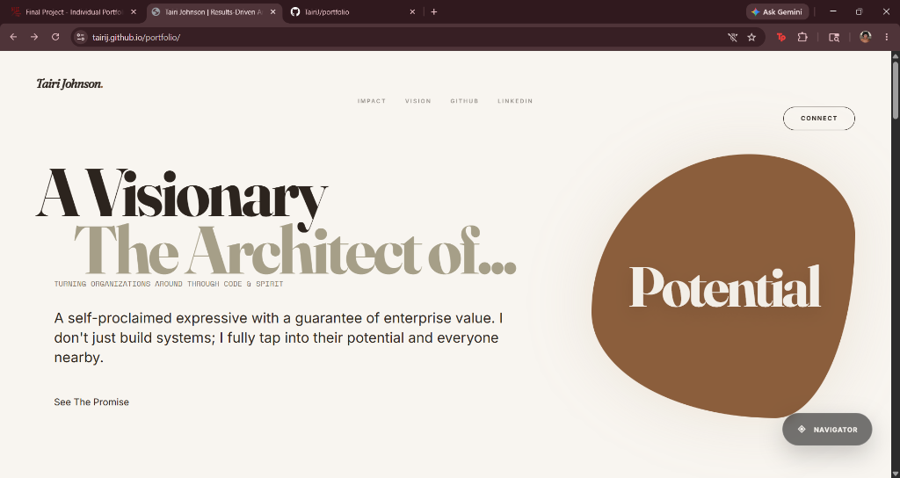

# Visionary Architect Portfolio - Tairi Johnson

[](https://tairij.github.io/portfolio/)

A high-fidelity, editorial-style professional portfolio showcasing expertise in AI architecture, systems transformation, and human-centric design.



## 🚀 Overview

This portfolio is a "Visionary Manifest" designed to demonstrate technical rigor and professional exuberance. It features a custom-built AI Navigator, glassmorphism aesthetics, and a "Liquid Architecture" layout that ensures a premium experience across all devices.

## 🛠️ Technical Arsenal

- **Intelligence Architecture**: RAG (Retrieval-Augmented Generation), MCP (Model Context Protocol), Vector Database Orchestration.
- **Enterprise Systems**: RBAC, AI Governance, Automated Training Systems.
- **Full-Stack Mastery**: High-performance web applications, Zero-latency tool calling.
- **Design**: Premium UI/UX, Glassmorphism, Micro-animations.

## 📁 Projects Featured

- **At The Helm**: A high-end Second Brain integrating LLMs and RAG.
- **Knowledge Proctor**: Enterprise-scale automated data ingestion and task-queueing for academia.
- **OmniFit Ecosystem**: AI-driven fitness ecosystem trained on specialized datasets.

## 🌐 Live Demo

Visit the live site: [https://tairij.github.io/portfolio/](https://tairij.github.io/portfolio/)

## 🛠️ Local Development

1. Clone the repository.
2. Open `index.html` in your browser or run a local server:
   ```bash
   python -m http.server 8081
   ```

---
Built with Spirit & Code by **Tairi Johnson**.

# Later Addidtion:

# 1. Portfolio + career research
- **Individual Record & Index:** https://github.com/tairij/portfolio#readme
- **Live Portfolio & Local Setup:** https://tairij.github.io/portfolio/ (Local preview: `python -m http.server 8081`)
- **Changed:** Researched three employer postings (C3 AI Forward Deployed Engineer – Federal, NYU IT AI Platform Engineer, and Norstella Senior Forge AI Engineer), compared Forward Deployed AI Engineering against AI Platform/Orchestration Engineering, mapped target responsibilities to shipped projects (*At The Helm*, *Knowledge Proctor*, and *OmniFit Ecosystem*), and documented the single-page "Liquid Architecture" layout comparison in the repository record.
- **Checked:** Verified live GitHub Pages deployment (`tairij.github.io/portfolio/`), tested local HTTP server rendering (`localhost:8081`), and reviewed role-to-evidence alignment against the three original job postings (peer feedback and wording refinements logged in the record).
- **Next:** Add quantitative latency/throughput metrics to project case studies and refine technical copy based on peer review feedback ahead of the Build milestone.

# 2. RAG app + technical research
- **Individual Record & Index:** https://github.com/tairij/portfolio#readme (Section 2: At The Helm RAG Architecture)
- **App Repository & Local Setup:** https://github.com/tairij/at-the-helm (Local dev stack: Node/TypeScript server, Rust `guardian` service, and Playwright E2E test harness)
- **Changed:** Evaluated Vector vs. Graph databases and chose a vector-first architecture with structured metadata filtering over a standalone graph database to fit free/low-cost hosting RAM limits; scoped *At The Helm*'s permitted knowledge base strictly to open-license and user-supplied materials (arXiv/open-access scholarly papers, YouTube transcripts retrieved via official caption APIs, public technical documentation, and user-uploaded personal notes/PDFs); defined a recursive chunking trace and three retrieval evaluation queries.
- **Checked:** Executed automated verification suite on the *At The Helm* foundation (15/15 passing tests: 11/11 ViTest RBAC middleware tests in `server/src/middleware/rbac.ts`, 2/2 Rust/Cargo database lifecycle tests in `guardian/src/db.rs`, and 2/2 Playwright E2E authentication tests in `client/tests/auth.spec.ts` — screenshot evidence attached).
- **Next:** Implement the recursive chunking (500–800 tokens) and embedding ingestion pipeline for permitted open-access sources, run the three retrieval evaluation queries to verify citation grounding and out-of-scope refusal, and deploy the hosted Build application.

